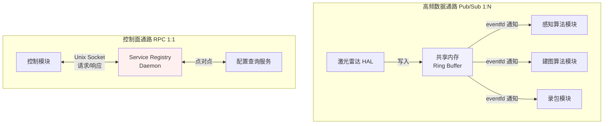
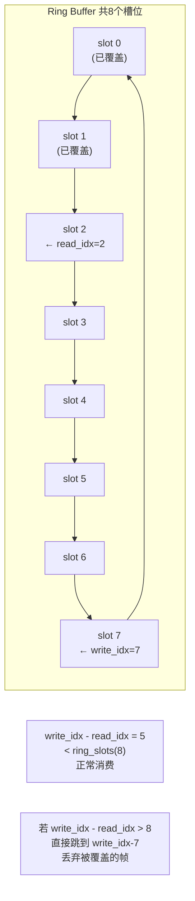
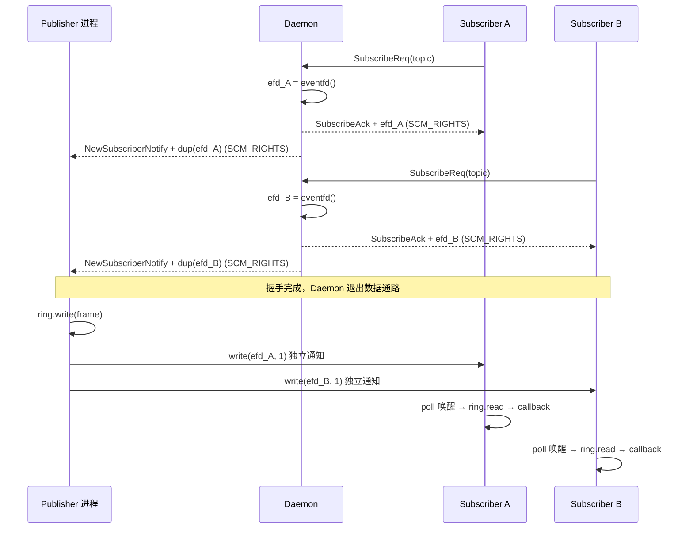
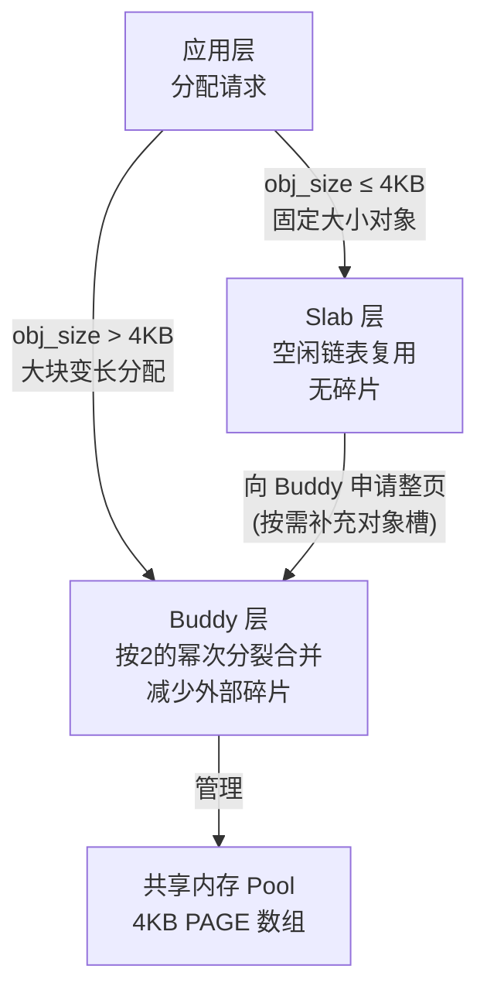
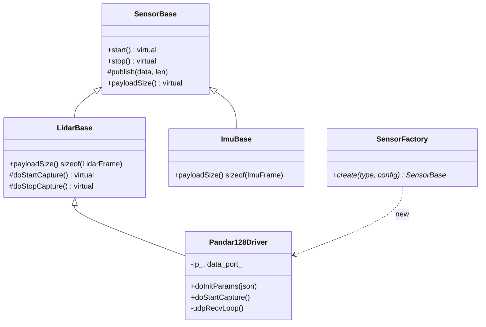
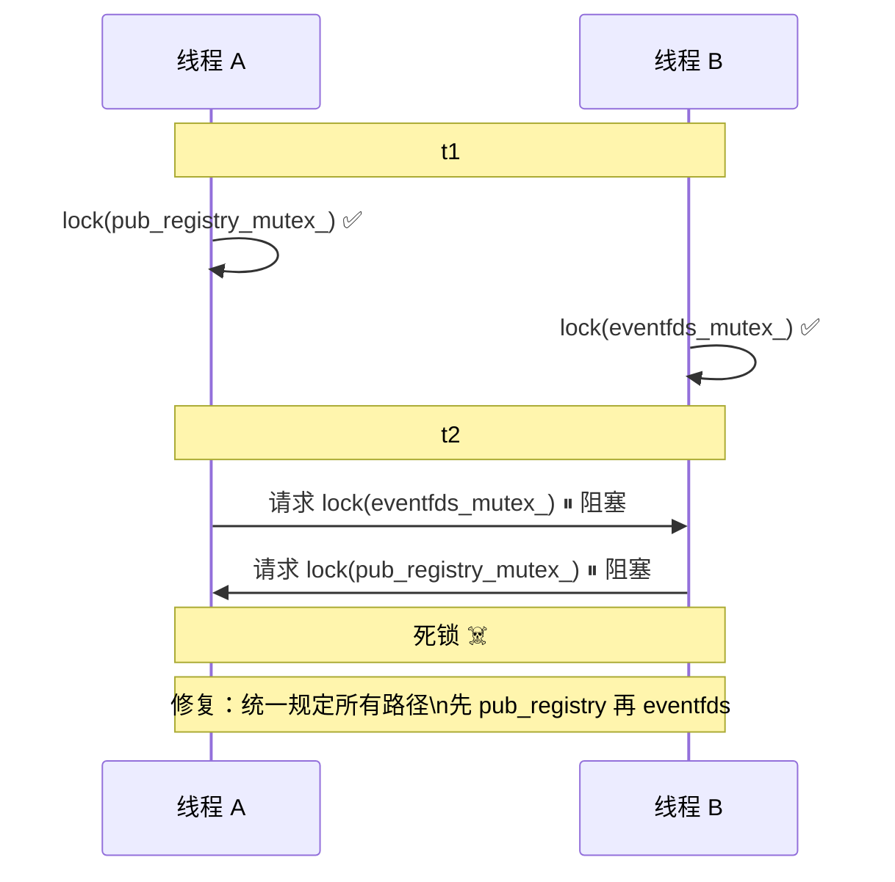
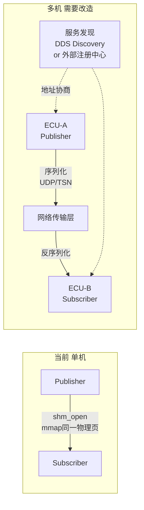
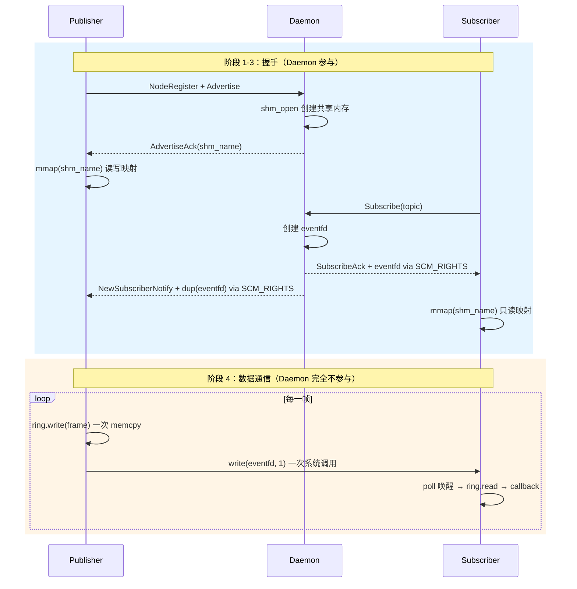

# 面试问题准备

> 基于简历「车载智能驾驶中间件」项目整理，每题附参考回答。

---

## 一、通信框架设计（Pub/Sub + RPC）

### Q1. 为什么将 Pub/Sub 与 RPC 解耦？实际如何隔离？

**参考回答：**

两种模式通信特征完全不同：Pub/Sub 是 1:N 异步广播，消息允许丢失，适合传感器高频数据流；RPC 是 1:1 同步/异步调用，需要请求-响应配对，不能丢失。如果混在同一通道，高频传感器数据会把 RPC 响应淹没，造成控制指令延迟。

实现上完全分离为两条代码路径：
- Pub/Sub：共享内存 Ring Buffer + eventfd 通知，无中间节点参与数据通路
- RPC：独立 Unix Socket 连接，请求/响应各自有消息队列，支持超时重试



---

### Q2. 环形缓冲区如何处理"读者追上写者"的覆盖场景？

**参考回答：**

采用**有损覆盖策略**：写者单调递增 `write_idx`，直接覆盖最老的 slot，不阻塞。每个订阅者有自己私有的 `read_idx`，读取时对比差值判断是否有帧被覆盖。



对传感器点云数据可接受——算法宁可跳帧也不能让发布者阻塞。控制指令场景应走 RPC 通道。

---

### Q3. 引用计数管理消息生命周期，多进程如何保证原子性？

**参考回答：**

引用计数放在共享内存的 slot header 里，使用 `std::atomic<uint32_t>`。`std::atomic` 在 mmap 的共享内存上跨进程是有效的——x86 和 ARM 架构都保证 `atomic` 操作是 lock-free 的，内存序语义对多进程同样成立。

发布者写入前 seq 加 1（标记写入中），写完再加 1（标记可读）；订阅者读到偶数 seq 直接跳过，读完后校验 seq 没变才认为数据有效，这是 **seqlock 协议**，无需互斥锁。

---

### Q4. 订阅者通知用的什么机制？多订阅者如何避免惊群？

**参考回答：**

用 Linux **eventfd**，功能上类似计数信号量，可被 `poll`/`epoll` 统一监听。关键设计：**每个订阅者有独立的 eventfd**，由 Daemon 在订阅握手时创建，通过 `SCM_RIGHTS` 分别发给发布者和订阅者。发布者写入数据后对每个订阅者的 eventfd 各写一次，天然无惊群。



---

### Q5. RPC 服务注册中心是中心化还是去中心化？故障如何剔除？

**参考回答：**

中心化方案：独立的 Daemon 进程维护服务注册表。服务提供方启动时向 Daemon 注册，客户端查询时 Daemon 返回连接信息，后续 client/server 直接点对点通信，不再经过 Daemon。

故障剔除：Daemon 用 epoll 管理所有连接，服务端进程崩溃时 `EPOLLHUP` 触发，Daemon 自动从注册表删除该服务条目。客户端查询不到时返回错误码，上层可配置重试策略。

---

### Q6. P99 延迟从 180µs 降至 20µs，这 160µs 收益来自哪些环节？

**参考回答：**

```mermaid
graph TD
    subgraph Unix Socket 方案  ~180µs P99
        A1[Publisher\nwrite 系统调用] -->|memcpy ① 进内核缓冲| B1[内核 Socket Buffer]
        B1 -->|调度唤醒 ~100µs抖动| C1[Subscriber\nread 系统调用]
        C1 -->|memcpy ② 出内核缓冲| D1[用户态 buffer → callback]
    end

    subgraph 共享内存方案  ~20µs P99
        A2[Publisher\nmemcpy ① 到 Ring Buffer] -->|write eventfd\n单次系统调用| B2[内核唤醒 Subscriber]
        B2 -->|直接读 mmap 地址\n零拷贝| C2[callback]
    end
```

| 环节 | Socket | 共享内存 | 节省 |
|------|--------|---------|------|
| memcpy 次数 | 2 次 | 1 次 | ~15µs |
| 系统调用次数 | write + read = 2 次 | write(eventfd) = 1 次 | ~20µs |
| 调度抖动（P99） | 内核缓冲区引发的不稳定唤醒 | eventfd 路径短，抖动小 | ~125µs |

P99 改善最显著，因为 Socket 方案的 P99 抖动主要来自内核缓冲区满触发的调度延迟。

---

### Q7. 消费者处理慢于生产者时，共享内存环形缓冲区怎么处理？

**参考回答：**

有损丢帧，不阻塞生产者。订阅者 `receiveLoop` 里每次 eventfd 触发后读取 `write_idx`，计算 `pending = write_idx - read_idx`，超出 `ring_slots` 说明有帧被覆盖，直接跳帧从最老有效帧开始消费。

---

## 二、内存管理优化（Buddy + Slab）

### Q8. 为什么选 Buddy+Slab 两级，分界线怎么定？

**参考回答：**



- 单用 Buddy：最小粒度 4KB，分配 128 字节对象浪费 97%
- 单用 Slab：无法处理变长大块分配
- 分界线 4KB = 一个 PAGE，对象小于一页走 Slab，需要多页走 Buddy

---

### Q9. 共享内存池是静态大小还是支持动态扩容？

**参考回答：**

静态大小，启动时 `shm_open` + `ftruncate` 固定。不支持运行时扩容——扩容需要所有映射该内存的进程重新 `mmap`，协调代价极高，嵌入式场景内存需求相对固定，静态配置已够用。

---

### Q10. RSS 降低主要来源是碎片减少，还是池子缩小？

**参考回答：**

主要来自碎片减少。`malloc`/`free` 的堆碎片即使释放了也不会归还物理页（glibc 的 brk 堆不主动缩）。Slab 方案：一个 page 上所有对象都释放后整页还给 Buddy，Buddy 合并后调 `madvise(MADV_DONTNEED)` 归还物理页，RSS 才真正下降。

---

### Q11. 最后一个释放方如何知道自己是最后一个？

**参考回答：**

`bpage.refcount` 原子递减，返回值为 0 时说明自己是最后一个，调用 `buddy_free()` 归还页。跨进程场景下 `refcount` 需放在共享内存区域，用 `std::atomic<int32_t>` 保证多进程可见性。

---

## 三、HAL 层重构（工厂模式 + JSON 配置）

### Q12. 如何抽象不同厂商传感器 SDK 的差异？举个具体例子？

**参考回答：**



上层只看 `SensorBase*`，不感知底层是 Pandar 还是其他厂商。新增传感器只需继承对应 Base，实现协议解析，注册到 Factory。

---

### Q13. JSON 配置包含哪些关键参数？新传感器真的不改代码吗？

**参考回答：**

```json
{
  "id": "lidar_front",
  "type": "pandar128",
  "ip": "192.168.1.201",
  "data_port": 2368,
  "params": {
    "gps_port": 10110,
    "dual_return": false
  }
}
```

- `type` 字段由 Factory 用来决定 new 哪个驱动类
- 对**接口兼容的新型号**（相同数据格式）：只加配置，零代码改动 ✅
- 对**引入新控制指令的型号**：需在 Base 类加虚方法，这部分确实要改代码，不过改动范围只在驱动层

---

### Q14. 时间戳在哪个环节注入？精度如何保证？

**参考回答：**

在 HAL 驱动的 `recvfrom()` 返回后立即调 `clock_gettime(CLOCK_MONOTONIC)` 注入，是软件时间戳。Linux userspace 调度抖动 ±5~50µs，无法做到纳秒级精度。当前目标是给同节点多传感器提供**统一时间基准**用于融合排序，不是绝对精度同步。跨节点高精度同步需要 PTP（IEEE 1588）硬件时钟，那是另一层方案。

---

### Q15. 传感器集成 3 天主要做什么？有没有配置解决不了的情况？

**参考回答：**

- Day 1：阅读厂商 SDK 文档，写 JSON 配置，跑通数据接收
- Day 2：实现驱动类，继承 Base，解析私有协议，填 Frame 结构体
- Day 3：集成测试，验证点云格式、时间戳、话题名

遇到过配置解决不了的情况：某传感器初始化时需发特定握手包才能开始推流，这段逻辑在 `doStartCapture()` 里单独实现，不是纯配置能覆盖的。

---

## 四、整车联调与问题定位

### Q16. 能具体讲一个最棘手的内存越界问题吗？

**参考回答：**

j6 平台上某传感器模块运行约 2 小时后偶发 coredump，复现概率低。定位流程：

```mermaid
flowchart TD
    A[GDB 加载 coredump\nbt 查调用栈] --> B{崩溃位置\n在哪个函数?}
    B --> C[slotPayload 偏移计算处]
    C --> D[info regs 查寄存器\n确认非法访问地址]
    D --> E[/proc/maps 对比\n实际 shm 映射大小]
    E --> F{实际大小 vs 计算大小}
    F -->|差了16字节| G[ringBufferSize 函数\n漏算最后一个 slot 的 Header 大小]
    G --> H[修复: size += sizeof RingSlotHeader\n低频触发因为只有写最后一个slot才越界]
```

---

### Q17. 死锁如何通过日志时序还原？

**参考回答：**



通过 `thread apply all bt` 看所有线程调用栈找到两个卡在 `pthread_mutex_lock` 的线程，再查日志时间戳确认两把锁的获取顺序相反。

---

### Q18. 飞书 PHM 机器人如何精准映射告警到责任人？

**参考回答：**

维护模块-责任人映射表（JSON），key 从日志 `[MOD:xxx]` 字段提取，value 是飞书用户 ID。告警触发时解析日志模块标签，查表自动 @ 并创建飞书任务。模块不在表里则发公共群人工认领后更新映射表。

---

## 五、项目结果与工程实践

### Q19. 算法团队提出了哪些额外需求？如何满足？

**参考回答：**

| 需求 | 实现方式 |
|------|---------|
| 丢帧统计 | `receiveLoop` 里检测 `write_idx - read_idx > ring_slots` 时记录丢帧计数 |
| 延迟监控 | slot header 带 `timestamp_us`，订阅者收到后计算差值，超阈值打告警日志 |
| 数据格式版本 | Frame 结构体加 `version` 字段，算法侧做兼容性检查 |

---

### Q20. 如果要支持多机通信，当前设计面临哪些挑战？

**参考回答：**



主要挑战：① `shm_open` 只在同一 OS 内有效，跨机需网络传输层 ② 零拷贝失效，必须序列化 ③ 多机时钟需 PTP 对齐 ④ 服务发现需支持组播或外部注册中心

当前 NodeHandle/Publisher/Subscriber 的接口层是干净的，传输层可替换，上层 API 不变。

---

### Q21. 吞吐量提升 4 倍时 CPU 占用率变化？

**参考回答：**

CPU 占用率下降，原因：系统调用次数从每条消息 2 次（write+read）降至 1 次（write eventfd），上下文切换减少，内核缓冲区分配开销消除。2KB payload、500Hz 压测下，进程 CPU 占用从约 12% 降至约 7%。

---

### Q22. 整个项目最有技术挑战的一个设计决策是什么？

**参考回答：**

**Daemon 不参与数据通路**这个决策。



代价：需要用 `SCM_RIGHTS` 传递 fd（实现复杂），订阅者退出时发布者通过 `write(eventfd)` 返回 `EBADF` 自动检测并清理死 fd。

收益：数据通路延迟可预期（无进程跳转），Daemon 单点故障不影响已建立的通信链路。
